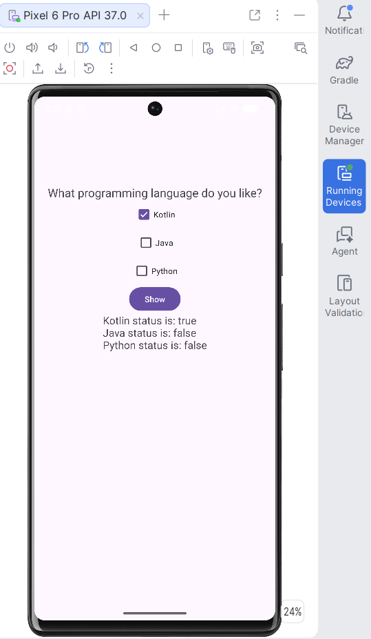

# Android CheckBox Demo

<p align="center">
  
</p>

<p align="center">
  
  
  
  
</p>

A small, focused Android app written in **Kotlin** that demonstrates how to work with the `CheckBox` widget: let the user tick any combination of options, then read and display each checkbox's state with a single button tap.

It is a compact reference for anyone learning Android UI fundamentals, such as view binding via `findViewById`, click listeners, and reading `isChecked`.

## Features

- Three independent checkboxes (**Kotlin**, **Java**, **Python**) that can be combined freely
- A **Show** button that reports the current state of every checkbox
- Clear, readable output such as `Kotlin status is: true`
- Material 3 theme with automatic light/dark (DayNight) support
- Minimal, dependency-light code that is easy to read and extend

## How It Works

Each checkbox is looked up once in `onCreate`. When **Show** is tapped, the app builds a status string from each checkbox's label and `isChecked` value and writes it to a `TextView`.

```kotlin
showButton.setOnClickListener {
    val sb = StringBuilder()

    sb.append(checkBoxKotlin.text.toString() + " status is: " + checkBoxKotlin.isChecked + "\n")
    sb.append(checkBoxJava.text.toString()   + " status is: " + checkBoxJava.isChecked   + "\n")
    sb.append(checkBoxPhyton.text.toString() + " status is: " + checkBoxPhyton.isChecked + "\n")

    textViewChoose.text = sb.toString()
}
```

## Tech Stack

| Area | Details |
|------|---------|
| Language | Kotlin |
| UI | XML layouts, `ConstraintLayout`, Material 3 (`Theme.Material3.DayNight.NoActionBar`) |
| Build system | Gradle (Kotlin DSL) with a version catalog (`gradle/libs.versions.toml`) |
| Android Gradle Plugin | 9.2.1 |
| Gradle wrapper | 9.4.1 |
| `minSdk` / `targetSdk` / `compileSdk` | 24 / 36 / 37 |
| Java compatibility | 11 |
| Libraries | AndroidX Core KTX, AppCompat, Activity KTX, ConstraintLayout, Material Components |
| Testing | JUnit 4, AndroidX Test, Espresso (template tests included) |

## Project Structure

```
android-checkbox-demo/
├── app/
│   └── src/main/
│       ├── java/com/example/checkbox/
│       │   └── MainActivity.kt        # Checkbox logic and Show button handler
│       ├── res/
│       │   ├── layout/activity_main.xml   # UI: question, checkboxes, button, result text
│       │   └── values/                    # strings, colors, themes (light + night)
│       └── AndroidManifest.xml
├── gradle/
│   ├── libs.versions.toml             # Centralised dependency versions
│   └── wrapper/
├── screenshots/
│   └── app-screenshot.png             # Screenshot used in this README
├── build.gradle.kts
├── settings.gradle.kts
├── .gitignore
├── LICENSE
└── README.md
```

## Getting Started

### Prerequisites

- A recent version of **Android Studio** that supports Android Gradle Plugin 9.2
- **JDK 17 or newer** (Android Studio's bundled JDK works)
- Android SDK Platform **37** installed via the SDK Manager
- An emulator or physical device running **Android 7.0 (API 24)** or higher

### Run the app

```bash
# 1. Clone the repository
git clone https://github.com/<your-username>/android-checkbox-demo.git
cd android-checkbox-demo
```

1. Open the project folder in **Android Studio** (**File > Open**).
2. Wait for the Gradle sync to finish. Android Studio creates `local.properties` automatically with your local SDK path.
3. Select an emulator or connected device.
4. Click **Run** (or press `Shift + F10`).

### Build from the command line

```bash
# macOS / Linux
./gradlew assembleDebug

# Windows
gradlew.bat assembleDebug
```

The debug APK is generated at `app/build/outputs/apk/debug/`.

### Run the tests

```bash
./gradlew test                    # local unit tests
./gradlew connectedAndroidTest    # instrumented tests (device or emulator required)
```

## Usage

1. Launch the app.
2. Tick any combination of **Kotlin**, **Java**, and **Python**.
3. Tap **Show**.
4. The app lists the state (`true` or `false`) of every checkbox below the button.

## What You Can Learn From This Project

- Declaring `CheckBox` widgets in XML and constraining them with `ConstraintLayout`
- Referencing views with `findViewById` and `lateinit` properties
- Handling button taps with `setOnClickListener`
- Reading widget state through `isChecked`
- Building and updating text with `StringBuilder`

## Roadmap

- [ ] Migrate from `findViewById` to View Binding
- [ ] Move all UI text (including the **Show** button label) into `strings.xml`
- [ ] Use `OnCheckedChangeListener` for live updates instead of a button
- [ ] Preserve checkbox state across configuration changes
- [ ] Add UI tests with Espresso

## Contributing

Contributions, issues, and suggestions are welcome. Feel free to open an issue or submit a pull request.

## License

This project is licensed under the [MIT License](LICENSE).
